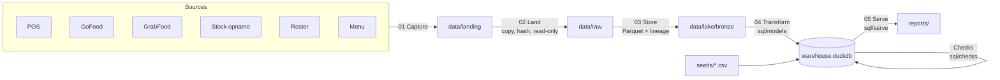

# Architecture

## Same layers, two sizes

| Layer | Laptop (this repo) | Production (airline lakehouse) | Move up when… |
|---|---|---|---|
| Capture | Monthly CSV exports | Datastream: every insert, update and delete, within minutes | Decisions need data within the day |
| Land | `data/raw/`, read-only, SHA-256 manifest | Cloud Storage bucket, object versioning, retention lock | More than one person or machine writes data |
| Store | Parquet files, one per raw file | Apache Iceberg: snapshots, schema evolution, time travel | Data outgrows a laptop, or tables need updates and deletes |
| Transform | Plain SQL files run by DuckDB | Spark on Dataproc for heavy jobs, Dataform SQL in BigQuery | Data reaches tens of GB, or runs take hours |
| Checks | SQL queries that return failing rows | Dataform assertions, alerts to the on-call channel | People rely on the output without looking at it |
| Serve | DuckDB file + static HTML report | BigQuery + Looker dashboards | Outlet managers need a live view |
| Schedule | `make all` | Cloud Composer (Airflow) | It must run daily with nobody pressing run |
| Access | Your laptop | IAM, VPC Service Controls, column-level policy tags | Any personal data, or any second team |

## Principles that hold at both sizes

1. **Raw is immutable.** Every fix is code. A corrected export arrives as a new file.
2. **Type and rename once, in staging.** Timezones, outlet names and item names are resolved in one place.
3. **Reference data is code.** Menu aliases, recipes, outlets and the calendar live in `seeds/` and go through review.
4. **Checks fail loudly.** An error stops the run before anything is served. A warning is visible in the report.
5. **Personal data stops at raw.** Staging selects only what the forecast needs.
6. **One command rebuilds everything.** If a teammate can't run it from a clean clone, it isn't done.

## Grain of the main tables

| Table | One row is |
|---|---|
| `clean_sales` | one order line, any channel, local time, our item ID |
| `clean_stock` | one ingredient at one outlet on one day, with the sell-out time |
| `mart_demand_hourly` | one outlet × item × date × opening hour, with `is_censored` |
| `mart_stock_plan` | one ingredient × outlet × day to order |
| `mart_staff_plan` | one outlet × day × shift |
